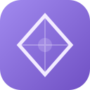
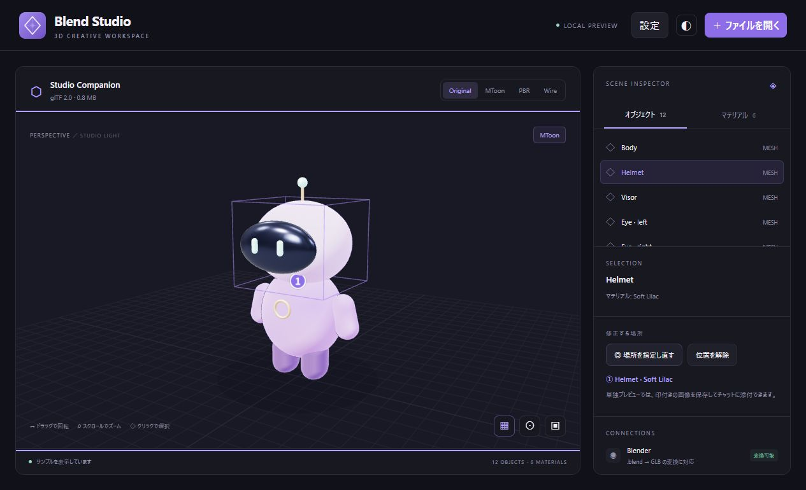

# Blend Studio

**3Dモデルを見ながら、修正したい場所をチャットに伝える。**

[English](README.en.md) · [Releases](https://github.com/Maguro-Tsukiji/blend-studio/releases) · [導入手順](docs/INSTALLATION.md) · [開発参加](CONTRIBUTING.md) · [変更履歴](CHANGELOG.md)

[](https://github.com/Maguro-Tsukiji/blend-studio/actions/workflows/ci.yml)

Blend Studioは、`.blend`・`.glb`・`.vrm`を表示するローカルMCP Apps／OpenAI MCP Extensionsプラグインです。PBR・MToonの描画、部位・マテリアルの選択、モデル表面への位置指定に対応しています。

モデルに①②③の印を付けて、ホストのチャットで「①の毛先を短く、②の袖を広くして」と依頼できます。ファイル名、選択した部品、マテリアル、複数の指定位置、視点、VRMAの再生状態をチャットへ共有します。

**現在は0.1.13の実験段階です。表示と修正箇所の共有を実装しています。Blenderのライブ編集とTripoでの生成は未接続です。**



*画像はプロジェクト同梱のStudio Companionです。単独プレビューのため、チャットへの共有は行っていません。*

## 主な機能

| 機能 | 対応内容 |
|---|---|
| GLB / VRM | 埋め込み画像付きglTF 2.0、VRM 0.x / 1.0を表示 |
| Blend | ローカルBlenderでプレビュー用GLBへ変換。元ファイルを上書きしません |
| マテリアル | PBR、Unlit、MToon拡張。Original / PBR / MToon / Wireを切り替え |
| 場所の指定 | 表面に最大8か所の番号付きの印。個別削除、回転・アニメーションへの追従 |
| 視点 | 正面・左側面・右側面・背面の平行投影と、自由に回せる3D表示 |
| ライティング | プリセット、露出、環境マップ・周囲光、主光源・補助光の明るさ・色・方向 |
| VRMA | 人型リグに動きを重ね、再生・停止・シーク・速度・ループを操作。ボーン対応を手動調整可能 |
| チャットの文脈 | 部品名、マテリアル、表面の位置、カメラなどをホストへ共有 |
| モデルタブ | モデルごとに視点・描画モード・選択・①を保持し、切り替えて比較 |
| 修正結果を開く | 修正依頼元の画面へ届け、元のタブの更新か新しいタブかを選択 |
| Blender保存の反映 | 作業ファイルを元タブに接続し、保存後に自動または手動で更新 |
| 表示と操作 | 回転、ズーム、部品・マテリアル選択、グリッド、明暗テーマ、印付き画像の保存 |
| Blender設定 | 画面から実行ファイルを設定・変更。設定は更新後も保持 |

## 動作環境

- **Node.js 22以上**。リリース配布物にはライブラリを同梱しています。
- **ローカルstdio MCPとMCP Appsを利用できるホスト**。チャットへの文脈共有には`ui/update-model-context`への対応が必要です。
- `.blend`の変換には**Blender**。GLB・VRMの表示には不要です。
- **Windowsでの導入を検証済み**。macOS・Linux向けの実行ファイル検出処理はありますが、導入とGUIは未検証です。

WindowsのCodexデスクトップ環境で、MCPの起動・ツール・画面の取得を検証しています。表示と文脈共有は公式AppBridgeを使った検証画面でも確認しています。CLI単体にはこの3D画面を表示する機能がありません。

この版はローカルプロセスを使います。GitHubに公開するだけではChatGPTのブラウザー版や公開プラグインディレクトリーへ接続されません。サイドバー・ファイル入口の表示はホストの対応状況に依存します。[ホストの導入仕様](https://developers.openai.com/plugins/build/plugins)も確認してください。

## Windowsでインストール

1. **[v0.1.13のビルド済みZIP](https://github.com/Maguro-Tsukiji/blend-studio/releases/download/v0.1.13/Blend-Studio-0.1.13.zip)**を取得します。新しい版は[Releases](https://github.com/Maguro-Tsukiji/blend-studio/releases)から確認できます。
2. ZIPを右クリックし、**「すべて展開」**します。
3. `blend-studio`フォルダー内の**`Install-Blend-Studio.cmd`**をダブルクリックします。
4. **「完了：Blend Studio」**が表示されたら、対応するデスクトップアプリを再起動します。
5. Blend Studioを選び、チャットで「Blend Studioを開いて」と依頼します。

インストーラーはNode.jsとCodexを検出し、現在のユーザーの設定領域へ登録します。ソフトの自動ダウンロードは行いません。GitHubの**Code → Download ZIPはソースコード**なので、下記のビルドが必要です。

Blenderは後から**画面上部の「設定」→「参照…」**で指定できます。導入、更新、再設定、トラブル対応は[導入ガイド](docs/INSTALLATION.md)にあります。

## 使い方

1. **「ファイルを開く」**からモデルを選択します。ドラッグ＆ドロップも使えます。
2. 視点ボタンや回転・ズームで対象を見つけ、右側の**「場所を追加」**を押します。
3. 修正したい表面を順にクリックして①②③の印を付けます。Escまたは「指定を終了」で追加を終えます。
4. **「チャットへ位置を共有しました」**を確認し、ホストのチャットに修正内容を入力します。

指定できる場所は各タブ最大8か所です。一覧の×で個別削除、「すべて解除」で全消去できます。残りの番号は変わらず、追加時も削除済みの番号を再利用しません。別の部品・マテリアルを選んでも印は残ります。同じタブのモデルを更新した場合、古い印は引き継ぎません。

### 視点とVRMAの再生

上部の**正面・左側面・右側面・背面**は平行投影です。ズームと平行移動ができ、**3D**に戻るとドラッグで回転できます。左右はキャラクター自身から見た方向です。正面が合わない場合は3Dで向きを合わせ、**「この向きを正面にする」**を押します。

1. 人型のボーンとスキンを持つ`.blend`・`.glb`・`.vrm`を開きます。
2. 下部の**「VRMAを読み込む」**から`.vrma`を選びます。
3. 再生・一時停止・停止・再生位置・速度・ループを操作します。動きの途中で止め、複数の修正ポイントを指定できます。
4. 一般リグで自動対応が合わなければ**「ボーン対応」**で割り当てます。腰・背骨・頭は必須で、基準姿勢はTポーズを想定しています。

`.blend`の作業ファイルはそのまま使い、変換した表示用モデルにVRMAを重ねます。アニメーションをBlenderへ書き戻す機能や自動リギングはありません。一般リグでは体の動きのみ、VRMでは対応する表情・視線も再生します。32MiB以下の外部リソースを持たないVRMAを読み込み、複数クリップの場合は先頭を使用します。動き・対応設定・再生位置はタブごとに保持し、画面を閉じると失われます。

指定モードではEnterで画面中央の表面を指定、Escでキャンセルできます。共有に対応していないホストや単独プレビューでは、印付きの画像を保存してチャットに添付できます。画像は自動送信しません。

### ライティングを調整する

視点ボタンの横の**「☼ ライティング」**、または右側の**「ライティング」**を開きます。モデルを見ながらリアルタイムに反映します。

- **プリセット**：スタジオ（標準）・やわらかい・正面から・ドラマチック。
- **露出・環境光**：画面の露出、PBRの環境マップ、周囲光の明るさと色。
- **主光源・補助光**：それぞれの明るさ・色・水平角・高さ。色はカラーピッカーまたは`#RRGGBB`で指定できます。
- **リセット**：標準のスタジオ設定へ戻します。

初期ライティングは描画方式で分かれます。元のマテリアルがMToonなら、OriginalでもMToon用を自動で使います。MToon用の標準値は**露出0.8・周囲光0.2・主光源1.0・補助光0.2**で、白い髪や衣装の陰影が薄くなりすぎないようにしています。PBR用は従来の値を使用します。ほかのプリセットもMToon用に明るさを抑えています。

未調整の状態では描画モードに合わせて自動で切り替わります。プリセットを選んだりスライダー・色を調整した後は、その設定をモード変更でも保持します。**「リセット」**で、現在の描画方式に合う初期設定と自動切り替えへ戻ります。パネルに「自動」か「手動設定を保持中」かを表示します。

ライトの方向は設定したモデルの正面が基準です。カメラを回してもライトは回りません。設定はタブごとに保持し、Blender保存後の元タブ更新でも引き継ぎます。画面を閉じると失われます。これは表示用の調整で、元ファイルのライトやマテリアルは変更しません。環境マップはPBR用で、自己発光・Wire表示などでは調整の効果が限られます。

### 修正結果を依頼元の画面で開く

別の編集ツールで修正後のファイルができたら、チャットで**「修正版を依頼元のBlend Studioで開いて」**と伝えます。チャットが受け取った画面・タブ情報を使い、その画面に開き方の選択を表示します。

- **「修正依頼元のタブを更新」**：依頼した元のタブに修正版を表示します。別のタブを見ていても、依頼元を更新します。
- **「新しいタブで開く」**：元モデルの視点・描画モード・選択・①を残し、修正版を別の内部タブで表示します。

通常の「ファイルを開く」でも開き方を選べます。タブ横の**＋**は新しいモデルタブを追加します。タブの**×**で閉じます。タブは画面内のメモリーに保持され、画面を閉じると失われます。ディスク上の元ファイルは上書きしません。

依頼元はモデルの読込IDではなく、継続する編集セッションで識別します。会話の文脈が不足した場合、エージェントは`studio.sessions`で既存のセッションを確認できます。複数の候補がある場合は確認し、新しい画面を勝手に開きません。画面を閉じた場合はタブ自体を復元できません。開発者向けの手順は[ADAPTERS.md](docs/ADAPTERS.md)にあります。

### Blenderで保存しながら元タブで確認する

1. 確認に使うタブを選び、右側の**「編集中のファイル」→「作業ファイルを接続」**を押します。
2. **「参照…」**からBlenderで保存する`.blend`を選ぶか、絶対パスを入力します。
3. **「保存後に自動更新する」**を有効にして**「このタブに接続」**を押します。
4. Blenderで編集して保存すると、同じタブの表示が更新されます。自動更新を無効にした場合は**「今すぐ更新」**を押します。

視点・描画モード・表示位置を保ち、VRMAとボーン対応・再生状態を再適用します。リグ構造が変わり再適用できない場合は「ボーン対応」で確認してください。別のタブを見ているときも依頼元のタブを更新し、表示中のタブは切り替えません。すべての印と部品選択は更新時に解除します。保存中や読み込み失敗時は前の表示を残します。監視をやめるには**「接続を解除」**を押します。

対象は**最後にディスクへ保存した内容**です。未保存のBlender内部状態やライブ操作には接続しません。Blendの変換時間に応じて反映まで待つ場合があります。画面は開いたままにしてください。ファイルのバイナリーを外部へ送信せず、ユーザーのファイルも書き換えません。ファイル名・作業パスを含むセッション情報はローカル設定領域に保存し、24時間使われなかった情報を次回利用時に整理します。

## ソースから試す

リポジトリのルートで実行します。

```sh
npm ci
npm run build
npm test
npm run preview
```

`http://127.0.0.1:43123`を開くと、同梱サンプルで表示を試せます。終了はCtrl+Cです。これは単独プレビューなので、ホストのチャットには接続しません。インストール済みのMCP画面を開く際に、localhostを開く必要はありません。

配布フォルダーは`npm run package`、公開用のソース一式は`npm run export:source`で生成できます。[開発ガイド](CONTRIBUTING.md)と[リリース手順](docs/PUBLISHING.md)を参照してください。

## 制約

- `.blend`はBlenderのglTFエクスポーターが表現できる範囲のプレビューです。任意のシェーダーノード、コンポジット、Blender固有の効果は完全には再現しません。
- `.blend`内のMToonノードをMToon拡張へ自動変換しません。MToonを保持する場合は対応GLBまたはVRMを使います。
- ファイル選択から読む`.blend`の外部テクスチャは、事前にBlenderでパックしてください。
- Draco圧縮・KTX2・外部URLや外部ファイルを参照するGLBは未対応です。MeshoptはホストのWebAssembly対応にも依存します。
- VRMAは人型のスキン付きリグが対象です。任意リグの自動変換、足の接地補正、Blenderへのアニメーション保存は未対応です。
- 1ファイル256 MiBまで。1画面最大8モデルタブ・読込GLBの合計512 MiBまで。描画時のメモリー使用量はこれより大きくなります。サーバーにも同じアセット保持上限があり、古いアセットは再読み込みが必要になる場合があります。
- 印の位置はプレビュー上の座標・三角形です。Blenderの元データの頂点番号や座標へ直接適用できません。

## データの扱い

モデルの解析・変換・描画はローカルで行います。モデルのバイナリーをこのプラグインから外部サービスへ送信する機能はありません。

チャット連携では、ファイル名・部品名・マテリアル名・指定位置・視点などの**モデル文脈をホストへ共有**します。ホスト側の保存・送信は、そのサービスの設定とポリシーに従います。モデル文脈には機密の名称が含まれる可能性があります。

設定・ログ・一時データの保存場所は[導入ガイド](docs/INSTALLATION.md)、実装上の境界と脆弱性の報告方法は[SECURITY.md](SECURITY.md)を参照してください。

## 今後の方向

- Blenderの作業コピーを編集し、変更前後を比較できる連携
- Tripoの生成・再生成とジョブ管理
- 点に加え、複数箇所や範囲を指定する操作
- VRM・OS・ホストごとの検証拡充

設計案は[ADAPTERS.md](docs/ADAPTERS.md)にあります。実装済みの機能と予定の機能を区別して記載しています。

## 参加とライセンス

不具合報告・改善提案・Pull Requestを歓迎します。[CONTRIBUTING.md](CONTRIBUTING.md)の手順を確認してください。報告に私有モデル、APIキー、個人のパスを含めないようお願いします。

プロジェクトのコードと独自サンプルは[MIT License](LICENSE)です。依存ライブラリは[THIRD_PARTY_NOTICES.md](THIRD_PARTY_NOTICES.md)、同梱スキーマは[schemas/README.md](schemas/README.md)を参照してください。読み込むモデルやテクスチャの権利は、それぞれの権利者に帰属します。

Blend Studioは独立したプロジェクトです。OpenAI、Blender、Tripoの公式製品ではありません。
